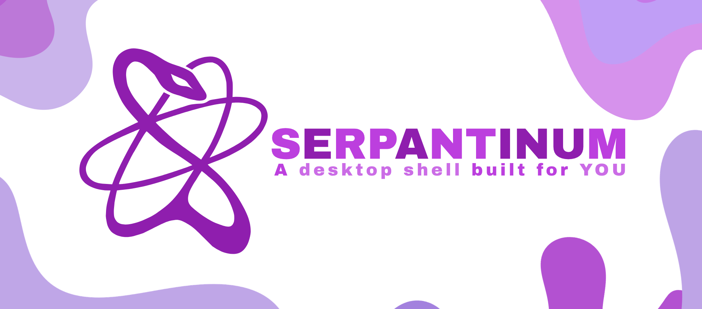
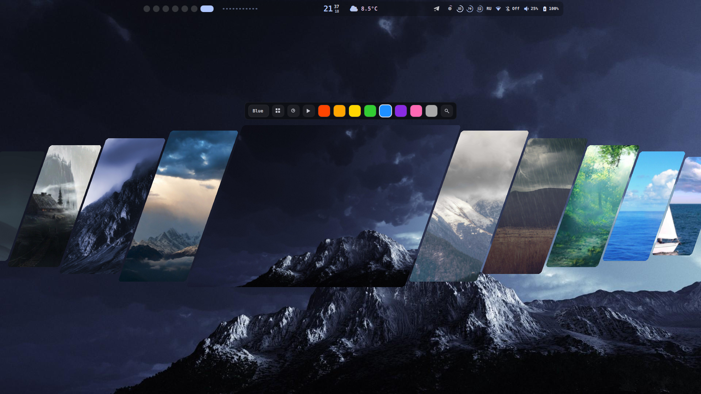
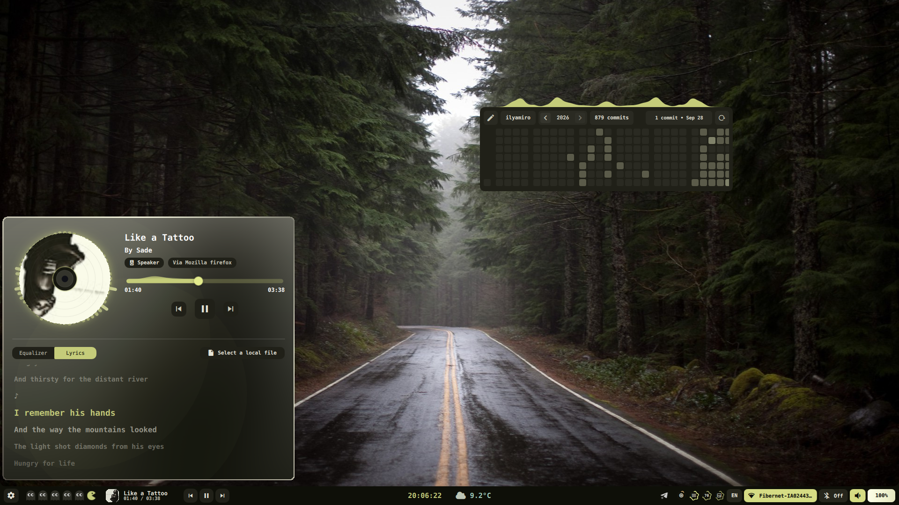
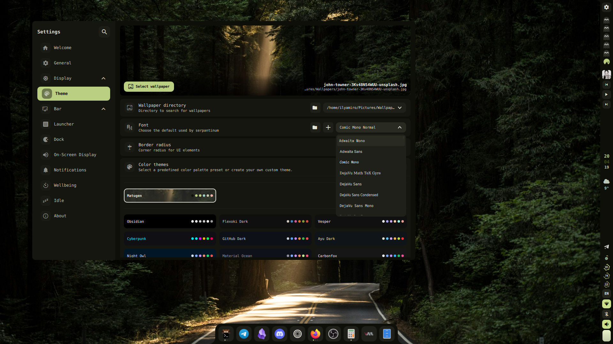
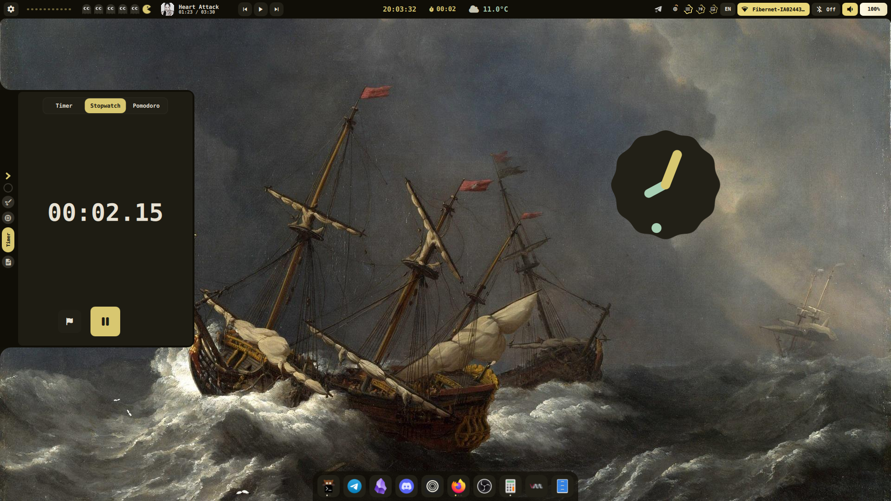

<div align="center">
  <a href="https://ko-fi.com/ilyamiro">
    
  </a>
</div>

<div align="center">
  
</div>

## Previews

| | |
|---|---|
|  |  |
|  |  |

---

> [!IMPORTANT]
> **Hey, join our subreddit!** Share your setups, ask questions and follow updates at **[r/serpantinum](https://www.reddit.com/r/serpantinum)**.
>
> [](https://www.reddit.com/r/serpantinum)

## Installation

> [!TIP]
> Full installation and configuration instructions live at **[serpantinum.dev](https://serpantinum.dev)**.

> [!IMPORTANT]
> **Migrating from v1:** All previous configuration will be backed up and unused. Configuration of compositor settings such as monitors, keybinds, and autostart is now up to you, as the project migrated from being dotfiles to being a shell.

### Arch Linux, Fedora, Void Linux, Gentoo and derivatives

For Arch-based distributions (including systemd, OpenRC, and other init systems), for Fedora-based distributions such as Nobara and Ultramarine, and for Void Linux (glibc and musl), run the automated installation script. It detects your distribution and uses `pacman`, `dnf`, `xbps` or Gentoo Portage. The Arch family includes CachyOS and EndeavourOS. The terminal installer uses the configured package repositories. Arch AUR or source builds require an explicit choice in the separate installer manager.

Use this installer:

```bash
curl -fsSL install.serpantinum.dev | bash
```

If this doesn't work, use:

```bash
bash -c "$(curl -fsSL https://raw.githubusercontent.com/ilyamiro/serpantinum/master/install/install.sh)"
```

> [!NOTE]
> To update Serpantinum Desktop, run the script again and choose **Start installation / update**.

From a checkout:

```bash
bash install.sh            # interactive terminal installer
bash install.sh --dry-run  # inspect detected targets and missing packages
bash install.sh --profile light
bash install.sh --profile full
```

Use ↑ and ↓ to navigate, Enter to select, and Esc to go back or exit. The installer asks before starting package and service changes. Ctrl+C interrupts the current stage. Completed package transactions are retained, and the installer log identifies where to resume. Logs are written under `${XDG_STATE_HOME:-$HOME/.local/state}/serpantinum` when installing. The dry run uses the local package database and saved options. When no compositor is selected, it previews Hyprland. It does not run an installation or refresh repository metadata.

The performance screen recommends a profile from RAM, CPU threads and available renderer information. **Light** uses static wallpaper fallbacks, reduces effects and GPU polling, and suspends optional desktop widgets and floating controls. **Full** restores the normal shell behavior and honors the user's existing visual preferences. Changing profiles edits only `general.performance` and creates a settings backup when the value changes.

On Gentoo, use amd64 with an active Wayland-capable graphics driver. Synchronize Portage and configure the repositories before running the installer. Quickshell 0.3 or newer and several desktop utilities are available in GURU. Hyprland requires a separately configured repository with a compatible Lua-enabled version. Portage previews the transaction and reports unresolved package masks, keywords and USE settings before asking for approval. Review its suggestions and apply any required package-specific changes yourself. The installer does not enable overlays or write Portage configuration. OpenRC and graphics-session integration need verification on a running Gentoo desktop. [Quickshell installation guide](https://quickshell.org/docs/v0.2.1/guide/install-setup/)

The existing installer manager can be opened with `bash install.sh --gui` or `bash install.sh --manager-tui` on the Arch and Fedora families. The original Bash interface is available as `bash install.sh --legacy-tui`. Run `bash install/tests/terminal_installer_test.sh` on Linux for the isolated provider and profile tests.

The graphical installer's **System updates** section checks the distribution's repositories, previews the full system transaction, and records its progress and result. Open it from a checkout with `bash install.sh --system-updates`, including on Void Linux. Live sessions can run the checks. AUR and Flatpak updates have separate actions when the corresponding tools are available.

---

### NixOS

See the [NixOS installation guide](https://serpantinum.dev/installation/nixos) for flake setup, the NixOS and Home Manager modules, and updating.

---

## Audio engine

The equalizer, balance, mono, channel swap, dynamic range modes and the dynamic EQ run on [serpantinum-audio](https://github.com/ilyamiro/serpantinum-audio), a small PipeWire processor that replaces EasyEffects. The installer and the packages install it, and on the first start after updating, Serpantinum hands your audio over from EasyEffects. See the [audio engine guide](https://serpantinum.dev/audio).

---

## Blue light filter

The blue light filter and its day and night schedule run on [serpantinum-gamma](https://github.com/ilyamiro/serpantinum-gamma), a small Wayland daemon that replaces wl-gammarelay-rs. The installer and the packages install it. Serpantinum starts it the first time a filter is turned on and stops it on exit.

---

## Supported compositors

Hyprland, Niri, Sway and Mango. The installer detects the running compositor and deploys its configuration. On Fedora, Mango is installed from the Terra repository. On Void Linux, Hyprland is installed from the third-party black-hole.dev repository.

---

## Running

To run the shell, launch `serpantinumd start`

For configuration, see the [configuration guide](https://serpantinum.dev/configure).

<br><br><br>

<div align="center">
  <h3>Thanks to all contributors</h3>
  <br>

  <a href="https://github.com/TheRinder2"></a>
  <a href="https://github.com/bizneskind-droid"></a>
  <a href="https://github.com/Pigeon78"></a>
  <a href="https://github.com/Eduarduar"></a>
  <a href="https://github.com/Spinty-dev"></a>
  <a href="https://github.com/MrDexstor"></a>
  <a href="https://github.com/coloramamoe"></a>
  <a href="https://github.com/Zyxilon"></a>
  <a href="https://github.com/gouthamkrishnap"></a>
  <a href="https://github.com/Stoltembergg"></a>
  <a href="https://github.com/andckadir"></a>
  <a href="https://github.com/ArseniiTkachuk"></a>
  <a href="https://github.com/MCUxDaredevil"></a>
  <a href="https://github.com/MILKv2"></a>
  <a href="https://github.com/pedrolourencosilva"></a>
  <a href="https://github.com/Vaspyyy"></a>
  <a href="https://github.com/Sergi122"></a>
  <a href="https://github.com/Syrup5845"></a>
  <a href="https://github.com/forteleaf"></a>
  <a href="https://github.com/kranks-uga"></a>
  <a href="https://github.com/zynx-real"></a>
</div>

<br><br>

---

## License

Copyright (C) 2026 Illia Miroshnichenko

This project is licensed under the GNU Affero General Public License version 3, or (at your option) any later version. See the [LICENSE.md](LICENSE.md) file for the full license text.

